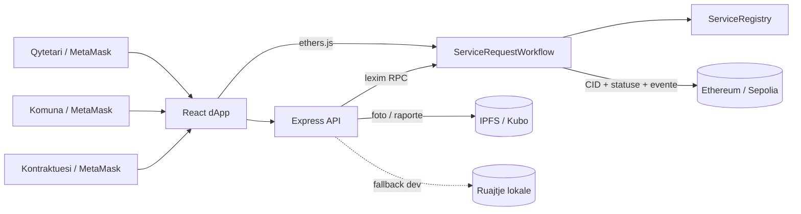

<div align="center">


# University of Prishtina

## Faculty of Electrical and Computer Engineering

**Study Program:** Computer and Software Engineering – Master  
**Course:** Blockchain Technologies  
**Group:**   

# CitizenReport

**Dataset Source:** [Kaggle – ](https://www.kaggle.com/datasets/xixama/yearhool-students-of-class-6-10)

### Professor:
Prof. Dr. Vehbi Neziri

**Date:** December 2026

</div>

---

# Projekti 9 - Kërkesa qytetare për shërbime komunale

Sistem Web3 ku qytetari raporton një problem publik, komuna e kategorizon dhe cakton kontraktuesin, kontraktuesi dorëzon dëshmi të punës dhe komuna e verifikon zgjidhjen. Gjurmët kritike ruhen në Ethereum; përshkrimet, fotografitë dhe raportet ruhen off-chain në IPFS ose në fallback lokal gjatë zhvillimit.

## Përputhja me kërkesat

- 2 smart contracts të lidhura: `ServiceRegistry` dhe `ServiceRequestWorkflow`.
- 4 role: qytetar, operator komunal, mbikëqyrës komunal, kontraktues (plus administratori që emëron zyrtarët).
- 9 statuse: Submitted, Categorized, Assigned, InProgress, WorkSubmitted, Verified, Rejected, Cancelled, Disputed.
- 15 evente të workflow-t dhe 7 evente të registry-t.
- 16 funksione kryesore të procesit.
- 6 pamje dApp: ballina, kërkesë e re, kërkesat e mia, komuna, kontraktuesi dhe detajet publike me historik.
- MetaMask, backend REST, dashboard/SLA, IPFS, indeksim eventesh dhe oracle AI.
- 72 teste për kontratat (përfshirë qasje të paautorizuar, konflikt interesi, nënshkrime të falsifikuara) + 6 teste backend.
- Skript seed me 8 kërkesa, 3 kategori dhe 3 statuse përfundimtare, plus një kërkesë të eskaluar, një të kontestuar dhe dy me vlerësim AI.

### Versioni 3 - "Syri i tretë"

AI (Google Gemini) krahason foton **para** (qytetari) me foton **pas** (kontraktuesi). Backend-i, si oracle, e nënshkruan vlerësimin me EIP-712 dhe kontrata e pranon vetëm me nënshkrimin e oracle-it të autorizuar. AI vetëm këshillon: nëse thotë "e pazgjidhur", mbikëqyrësi mund të verifikojë vetëm me arsyetim publik (`verifyAgainstAi`). Pa `GEMINI_API_KEY`, backend-i punon në modalitetin `mock` dhe UI e shfaq qartë si simulim. Detajet janë në [docs/VERSIONI-3.md](docs/VERSIONI-3.md).

Për AI reale: merr key te aistudio.google.com dhe vendos në `backend/.env` `AI_PROVIDER=gemini` dhe `GEMINI_API_KEY=...`. Mos e vendos key-n kurrë në Git.

### Versioni 2

- **Parimi "katër sy":** operatori kategorizon dhe cakton, mbikëqyrësi verifikon; askush nuk verifikon punën që e ka caktuar vetë, dhe kontraktuesi nuk mund të jetë zyrtar.
- **Eskalimi publik i SLA-së:** afati ruhet on-chain; pas tij kushdo mund ta eskalojë kërkesën.
- **Kontestimi:** qytetari ka 7 ditë për ta kontestuar zgjidhjen me dëshmi; operatori e rihap ose një mbikëqyrës tjetër e hedh poshtë me arsyetim.
- **Timeline:** faqja e detajeve tregon historinë e plotë nga eventet e indeksuara.

Dizajni i plotë është në [docs/VERSIONI-2.md](docs/VERSIONI-2.md). Llogaritë lokale: #0 administrator + operator, #1 dhe #3 qytetarë, #2 kontraktues, #4 mbikëqyrës, #6 oracle-i i AI-së (përdoret nga backend-i).

## Arkitektura



Modeli i të dhënave dhe vendimet teknike janë në [docs/ARKITEKTURA.md](docs/ARKITEKTURA.md). Analiza e sigurisë është në [docs/SIGURIA.md](docs/SIGURIA.md).

## Nisja lokale

Kërkohen Node.js 20+ dhe MetaMask.

```bash
npm run install:all
copy .env.example .env
copy frontend/.env.example frontend/.env
copy backend/.env.example backend/.env
```

Terminali 1 - blockchain lokal:

```bash
npm run node
```

Terminali 2 - deploy dhe të dhëna demonstruese:

```bash
npm run deploy:local
npm run seed:local
```

Kopjo adresat nga `deployments/localhost.json` në `frontend/.env` dhe `backend/.env`. Pastaj:

```bash
npm run dev:backend
npm run dev:frontend
```

Hap `http://localhost:5173`. Në MetaMask shto rrjetin `http://127.0.0.1:8545`, Chain ID `31337`, dhe importo vetëm një prej private keys testuese që shfaq Hardhat. Mos përdor asnjëherë wallet me fonde reale.

### IPFS

Me Kubo lokal aktiv në portin 5001, API përdor automatikisht endpoint-in `/api/v0/add`. Nëse Kubo nuk përgjigjet, skedari ruhet në `backend/data/` me CID të derivuar nga SHA-256; kjo e bën demonstrimin lokal të qëndrueshëm, por për dorëzimin në Sepolia rekomandohet IPFS real.

## Testimi

```bash
npm test
npm run coverage
npm run build
```

Testet mbulojnë autorizimin, kalimet e statuseve, kërkesën e dëshmisë para mbylljes, ndalimin e ndryshimit pas mbylljes, vlerësimin vetëm një herë dhe paginimin.

## Deploy në Sepolia

1. Krijo `.env` nga `.env.example`.
2. Vendos RPC URL dhe private key të një wallet-i vetëm testues.
3. Ekzekuto `npm run deploy:sepolia`.
4. Kopjo adresat nga `deployments/sepolia.json` në konfigurimet e frontend/backend.
5. Ndërto frontend-in me `npm run build`.

Private keys, seed phrase dhe API keys nuk duhet të futen në Git, video apo prezantim.

## Rrjedhat për demonstrim

1. Qytetari ngarkon fotografinë, regjistron kërkesën dhe e ndjek në “Kërkesat e mia”.
2. Komuna kategorizon kërkesën dhe cakton një kontraktues të autorizuar.
3. Kontraktuesi fillon punën dhe dorëzon dëshminë; komuna e verifikon; qytetari e vlerëson.

Skenari 8-10 minutësh është në [docs/DEMO.md](docs/DEMO.md).

## API kryesore

- `GET /api/health`
- `GET /api/categories`
- `GET /api/requests?citizen=0x...&status=0`
- `GET /api/dashboard`
- `POST /api/ipfs` me fushën multipart `file`
- `GET /api/files/:cid` vetëm për fallback lokal
- `GET /api/events?event=RequestVerified&requestId=1&address=0x...&limit=50` - evente të indeksuara nga të dy kontratat
- `GET /api/requests/:id/history` - historiku i plotë i një kërkese nga eventet (tx hash, blloku, koha)
- `GET /api/indexer/status` - gjendja e indeksuesit: blloku i fundit, numri i eventeve sipas llojit

### Indeksimi i eventeve

Backend-i indekson 14 eventet e `ServiceRequestWorkflow` dhe `ServiceRegistry` me `eth_getLogs`, në intervale blloqesh, dhe i mban në memorie. Në nisje rindërton indeksin nga `INDEXER_START_BLOCK`, pastaj kontrollon çdo `INDEXER_POLL_MS` milisekonda. Nëse Hardhat node riniset, indeksi rindërtohet automatikisht. Për Sepolia vendos `INDEXER_START_BLOCK` me vlerën `startBlock` nga `deployments/sepolia.json`. Nëse RPC-ja falas kufizon intervalin e `eth_getLogs`, zvogëlo `INDEXER_BLOCK_RANGE`.

## Integriteti akademik

Ky projekt përdor Solidity, Hardhat, ethers.js, React, Express, Multer dhe mjete standarde open-source. Kodi i gjeneruar ose asistenca e jashtme duhet të deklarohet sipas rregullave të lëndës. Studenti duhet ta kuptojë dhe ta mbrojë secilin komponent; mos dorëzo kode ose kredenciale që nuk mund t'i shpjegosh.
