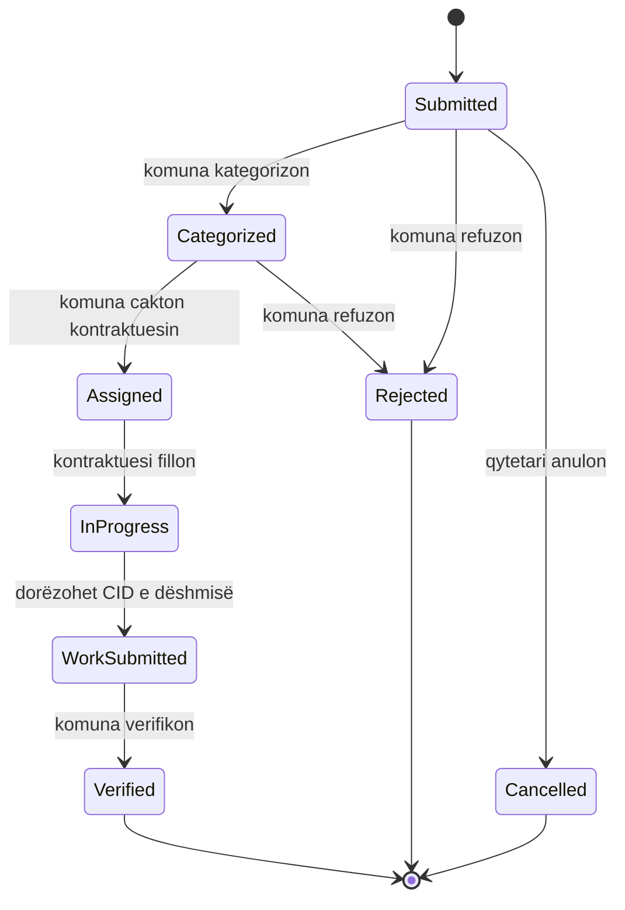

# Analiza dhe arkitektura

## Aktorët dhe use cases

| Aktori | Veprimet |
|---|---|
| Qytetari | Regjistron kërkesë, e anulon para pranimit, ndjek statusin, vlerëson zgjidhjen |
| Komuna | Menaxhon kategori/SLA, autorizon kontraktues, kategorizon, cakton, refuzon, verifikon |
| Kontraktuesi | Pranon detyrën e caktuar, fillon punën, ngarkon dëshmi |
| Publiku | Lexon dashboard-in, statuset dhe gjurmën e kërkesave |

## Cikli jetësor

Tre statuset përfundimtare janë `Verified`, `Rejected` dhe `Cancelled`. Nuk ekziston funksion që ndryshon një kërkesë pasi të hyjë në një prej tyre.

## Modeli i të dhënave on-chain

`Category`: emri, afati SLA në orë, statusi aktiv.

`ServiceRequest`: ID, qytetari, categoryId, kontraktuesi, statusi, CID e metadata-s, hash/lokacion i përgjithshëm, CID e dëshmisë, vlerësimi dhe timestamps.

Në blockchain nuk ruhen fotografi, dokumente ose të dhëna personale. Edhe lokacioni duhet të jetë i përgjithshëm; koordinatat e një prone private nuk duhen përdorur në demonstrim.

## Ndarja e kontratave

`ServiceRegistry` është burimi i autoritetit për komunën, kategoritë, SLA-të dhe kontraktuesit. `ServiceRequestWorkflow` e merr adresën e registry-t në constructor dhe e pyet për autorizim/kategori aktive gjatë çdo kalimi relevant. Kjo ndarje shmang duplikimin e roleve dhe e bën workflow-n të auditueshëm.

## Web2-Web3

Frontend-i nënshkruan transaksione me MetaMask. Backend-i është vetëm read/indexing + storage gateway: lexon kontratat me RPC, ndërton statistika SLA dhe ngarkon dokumente në IPFS. Backend-i nuk posedon private key dhe nuk mund të ndryshojë gjendjen on-chain.

## SLA

SLA përcaktohet për kategori. API llogarit një kërkesë të hapur si të vonuar kur `now - createdAt > slaHours * 3600`. Matja është informative; enforcement on-chain nuk përdoret sepse vonesa nuk duhet ta bllokojë zgjidhjen.

## Vendime të dizajnit

- Ownership me dy hapa redukton rrezikun e transferimit te adresa e gabuar.
- Dëshmia e punës është e detyrueshme përpara `Verified`.
- Vlerësimi lejohet vetëm nga qytetari origjinal, pas verifikimit dhe vetëm një herë.
- Pagination shmang kthimin e pakufizuar të të dhënave.
- Eventet lejojnë indeksim të mëvonshëm me The Graph ose një worker të dedikuar.
